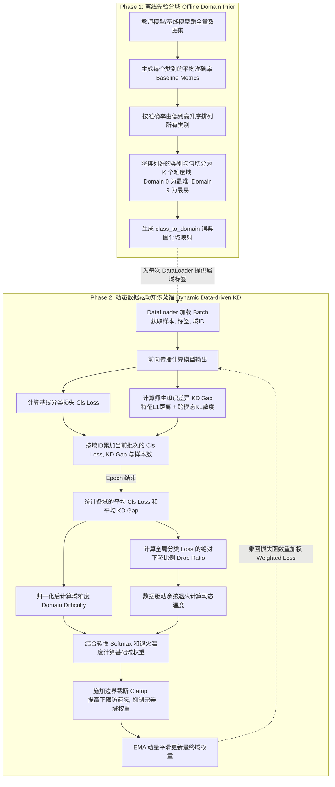

# 基于动态数据驱动的蒸馏领域自适应方法 (DDK) 报告

---

## 一、 研究动机与问题背景

### 1.1 问题背景
在知识蒸馏（Knowledge Distillation, KD）过程中，教师模型向学生模型传递知识时，数据集中不同类别的辨认难度存在显著差异。传统的知识蒸馏方法对所有样本一视同仁，这往往会导致：
- **难域欠拟合**：复杂类别（学生模型极难对齐教师特征的样本）没有得到足够的训练资源倾斜，导致学生模型在这部分“难解题”上表现极差。
- **域间极度不均衡**：虽然模型整体准确率尚可，但在不同难度域之间的准确率方差极大，存在明显的长尾认知缺陷。

### 1.2 核心研究目标
**如何利用教师模型的先验知识进行合理划分，并在训练中动态跟踪学生模型的真实学习进度，自适应地将算力资源向难度更大的薄弱域倾斜，同时防止已学会的简单域发生灾难性遗忘。**

---

## 二、 核心工作流程图

以下是整个 DDK 方法的工作流程，包含“离线先验分域”与“在线动态调节”两个阶段：

---

## 三、 核心数学公式总结

### 3.1 域难度双重评估公式 (TSD Difficulty)
域难度不再仅仅依赖学生分类误差，而是融合了分类误差与师生蒸馏差异（KD Gap）：
$$ \text{Gap}_{kd} = \| \text{Feat}_{stu} - \text{Feat}_{tea} \|_1 + \text{KL}(\text{Logits}_{stu} \| \text{Logits}_{tea}) $$
$$ D_{base}^{(d)} = \alpha \cdot \text{Norm}(\mathcal{L}_{cls}^{(d)}) + (1-\alpha) \cdot \text{Norm}(\mathcal{L}_{kd\_gap}^{(d)}) $$
为了加成难点的辨识度，将最终难度进行平方放大：
$$ D_{domain}^{(d)} = (D_{base}^{(d)})^2 $$

> **变量详细说明：**
> - **$\text{Gap}_{kd}$**: 样本维度的师生知识散度（Knowledge Distillation Gap）。
> - **$\text{Feat}_{stu}, \text{Feat}_{tea}$**: 学生与教师模型提取的深层特征（此处通过 $L_1$ 距离衡量特征空间差异）。
> - **$\text{Logits}_{stu}, \text{Logits}_{tea}$**: 学生与教师模型输出的预测逻辑值（通过 KL 散度衡量两者预测概率分布的差异）。
> - **$D_{base}^{(d)}$**: 域 $d$ 的基础难度评估指标。
> - **$\alpha$**: 分类损失与 KD 差异之间的核心平衡系数（代码对应 `tsd_alpha = 0.3`）。
> - **$\text{Norm}(\cdot)$**: 归一化操作，将损失/差异缩放到统一量级，使得二者可公平叠加。
> - **$\mathcal{L}_{cls}^{(d)}, \mathcal{L}_{kd\_gap}^{(d)}$**: 域 $d$ 内所有样本的平均分类交叉熵损失与平均 $\text{Gap}_{kd}$。
> - **$D_{domain}^{(d)}$**: 用于最终权重分配的非线性平方放大难度，目的是成倍拉开重难点与简单域的权重区别。

### 3.2 真正数据驱动的动态温度退火 (Data-driven Adaptive Annealing)
摒弃了基于时间/Epoch轮数的退火计算，改为基于**模型真实学习进度**（全局 Loss 相对初始状态的下降比例）：
$$ \text{DropRatio} = \frac{\mathcal{L}_{initial} - \mathcal{L}_{current}}{\mathcal{L}_{initial} + \epsilon} $$
计算 0 到 1 之间的实际优化进度 $p$：
$$ p = \min\left(1.0, \max\left(0.0, \frac{\text{DropRatio}}{\text{TargetDrop}}\right)\right) $$
*(代码中设定 TargetDrop = 0.70)*

采用基于 $p$ 的余弦退火动态调节温度 $\tau$：
$$ \tau(p) = \tau_{min} + 0.5 \cdot (\tau_{max} - \tau_{min}) \cdot (1 + \cos(\pi \cdot p)) $$
*(前期进度 $p$ 小，温度 $\tau$ 高达 3.0；后期 $p$ 接近 1，温度降至极限 0.2，放大难易权重差异以专注难例)*

> **变量详细说明：**
> - **$\text{DropRatio}$**: 全局分类损失相对初始状态的绝对下降比率。
> - **$\mathcal{L}_{initial}, \mathcal{L}_{current}$**: 训练早期记录的初始全局分类损失以及当前最新阶段所统计的平均分类损失。
> - **$\epsilon$**: 极小项（如 $10^{-6}$），用于避免出现除零异常。
> - **$p$**: 映射并被截断到 $[0, 1]$ 正常范围的实际优化进度系数。
> - **$\text{TargetDrop}$**: 用户定义的目标最高损失下降比例（代码设定为 $0.70$，即假定损失下降 70% 视为收敛进度 1.0）。
> - **$\tau(p)$**: 随优化进程自适应变换的时下动态退火温度。
> - **$\tau_{max}, \tau_{min}$**: 温度退火过程设计的上下界参数（最高上限 $3.0$，最低极限 $0.2$）。

### 3.3 域权重分配与遗忘保护机制 (Anti-Forgetting Reweighting)
将难度和温度映射为域注意力系数：
$$ \tilde{w}^{(d)} = K \cdot \frac{\exp(D_{domain}^{(d)} / \tau(p))}{\sum_{j=1}^{K} \exp(D_{domain}^{(j)} / \tau(p))} $$

**截断保护 (Clamp & Regularization)**：防止高难度域吸走全部算力导致简单域发生“灾难性遗忘”：
$$ \bar{w}^{(d)} = \text{Clamp}(\tilde{w}^{(d)}, w_{min}, w_{max}) $$
*(代码中保守设置为 $w_{min}=0.65, w_{max}=1.45$)*。
**完美域豁免**：若某域 $\mathcal{L}_{cls} < 0.05$（即已完美掌握），则强制压制其权重 $\le 0.65$。

### 3.4 权重的动量平滑 (EMA Update)
利用指数移动平均保证权重的平滑演进：
$$ w_{final}^{(d)} = \beta \cdot w_{old}^{(d)} + (1 - \beta) \cdot \bar{w}^{(d)} $$
*(代码中动量因数 $\beta = 0.8$)*

> **变量详细说明：**
> - **$\tilde{w}^{(d)}$**: 域 $d$ 在经过难度放大与温度退火约束后基于 Softmax 派发的基础专注权重。
> - **$K$**: 系统所分配的难度集群/域总数（乘回 $K$ 是为使得各域权重理论期望锚定在 $1.0$）。
> - **$\bar{w}^{(d)}$**: 附加遗忘保护上下界截断后获得且规避了过度偏差的干预权重。
> - **$w_{min}, w_{max}$**: 权重的硬性兜底下限（设为 $0.65$）与抑制上限（设为 $1.45$），核心在于防脱靶。
> - **$w_{final}^{(d)}$**: 当轮更新完毕被最终带入下一步迭代的本域平滑权重值。
> - **$w_{old}^{(d)}$**: EMA 框架下过去所累积保留的历史域权重。
> - **$\beta$**: 指数移动平均动量平滑记忆因子（代码设定衰减记忆率 $\beta=0.8$）。

---

## 四、 核心创新点总结

| 创新维度 | 传统方法缺陷 | 我们的 DDK 方法设计 (Innovation) | 解决的痛点 / 带来的收益 |
|---------|------------|-------------------------------|------------------------|
| **1. 课程设置起点** | 随机打散样本，或仅依靠在线网络自身的初期输出作为难度评判（极不稳定） | **离线先验与在线后验混合分段**：先用极强的教师模型把测试集过一遍计算真实准确率，排解出客观的“域难度词典”作为先验。 | 提供了冷启动时最稳定的课程划分，避免了初期在线难度的严重抖动误判。 |
| **2. 难度度量标准** | 仅依赖纯分类任务 Loss (Student Loss) | **引入双重反馈 TSD (Teacher-Student Discrepancy)**：除了看学生分类结果对错，还衡量“学生和老师解题思路的差异大小”(KD Gap)。 | 能精准捕捉出“教师教不好，且学生也极难模仿”的核心顽固样本群。 |
| **3. 温度退火机制** | 温度随训练时间/Epoch强制定向衰减（例如固定的线形/余弦退火时间表） | **真正数据驱动的自适应退火**：温度调节直接绑定全局分类 Loss 的绝对下降比例进度。如果模型中途优化卡壳现象，退火过程也会主动放缓。 | 确保“探索(Exploration)”和“剥削(Exploitation)”的平衡严格跟随模型真实吸收知识的进度。 |
| **4. 权重极值处理** | Softmax 很容易导致难例赢者通吃，使简单类别的权重逼近 0 | **带完美域豁免与下限兜底的白名单机制 (Anti-Forgetting)**：强制提升最低权重至 0.65；并特殊处理极低 Loss的“完美域”。 | 从根本上阻断了长尾极度加权带来的简单样本灾难性遗忘问题。 |

---

## 五、 实验结果 (待填充)

| 方法 | Test Acc ↑ | Domain Acc(域平均) ↑ | Acc Std(标准差) ↓ |
|------|:---:|:---:|:---:|
| Strong Baseline（不带 DDK） | X% | X% | X% |
| **+ DDK (Ours)** | **X%** | **X%** | **X%** |
| 提升 | **+X%** | **+X%** | **-X%** |

**结果解读提示**：
1. **域间公平性改善显著**：标准差应该有大幅度下降，说明蒸馏学习后各难度域之间差距缩小，避免偏科现象。
2. **重难点域突破**：原先最难的域（Domain 0/1）准确率应获得远超平均水平（如 10% 以上）的跃迁。

---

## 六、 后续消融计划建议

- [ ] **A. TSD 度量消融**：只使用 Cls Loss 衡量难度 vs 加入 KD Gap 的双重衡量。
- [ ] **B. 动态退火消融**：使用传统的基于 Epoch 数的固定余弦退火 vs 当前基于真实 Loss 下降比例的自适应退火。
- [ ] **C. 边界截断消融**：验证最低 0.65 下界的防遗忘机制对于维持整体泛化能力的不可或缺性。
